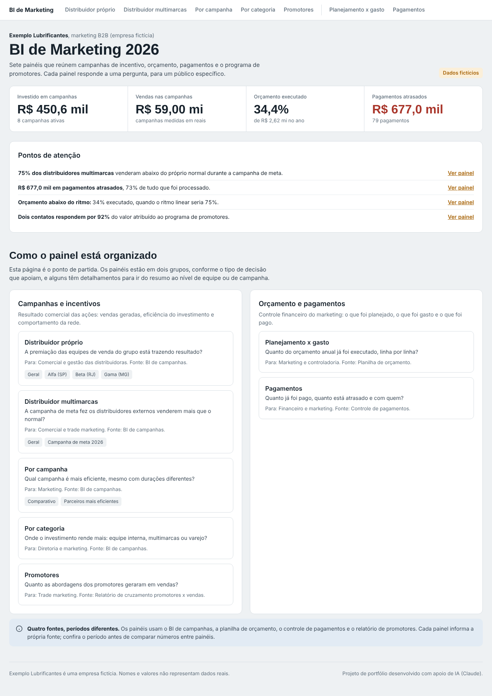
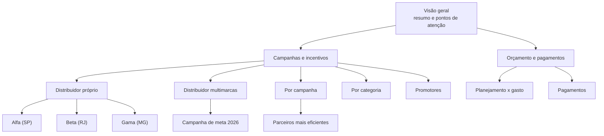
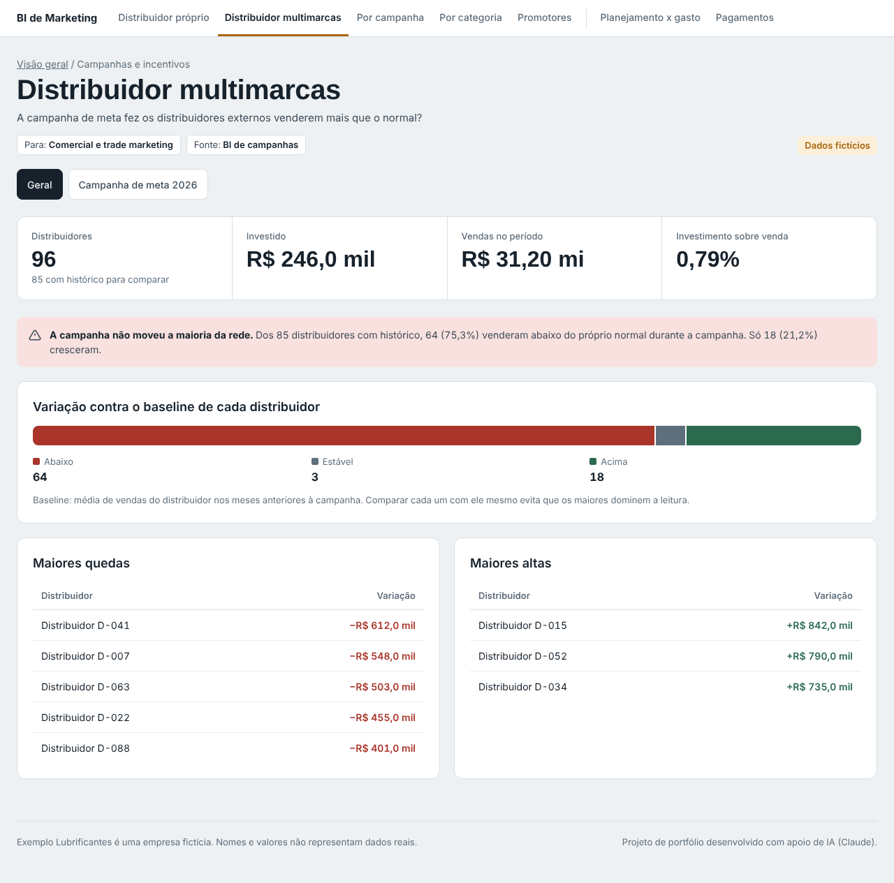
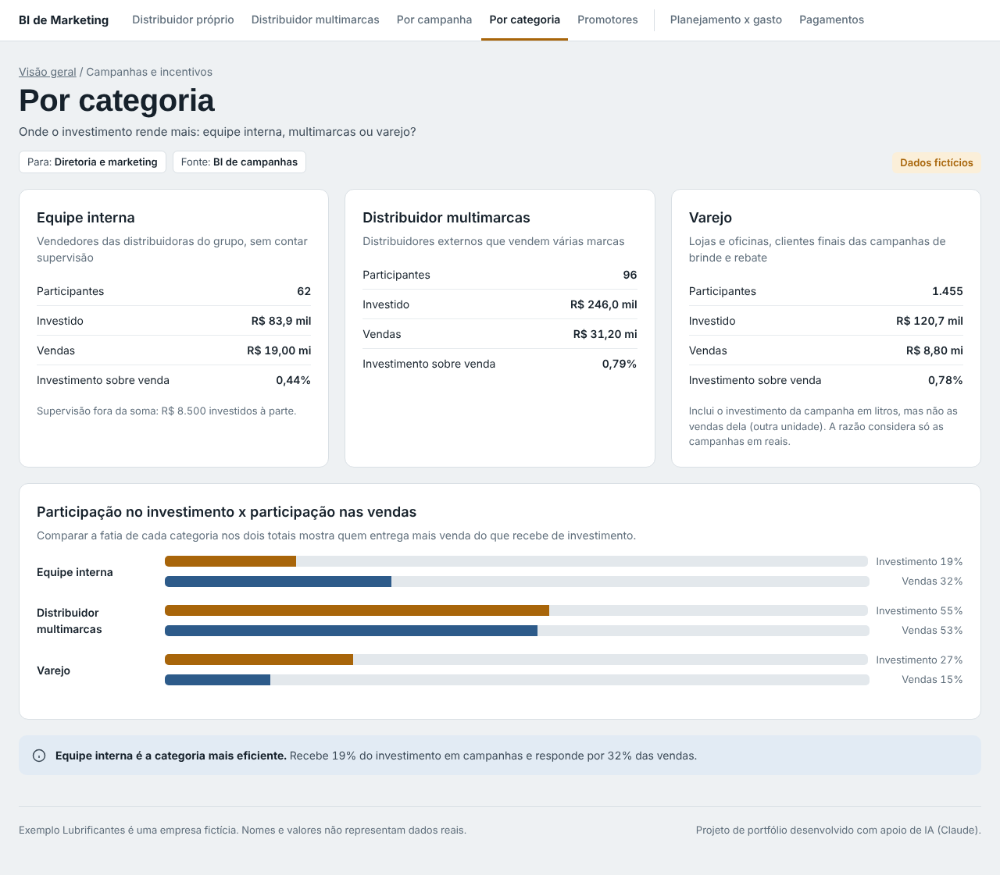
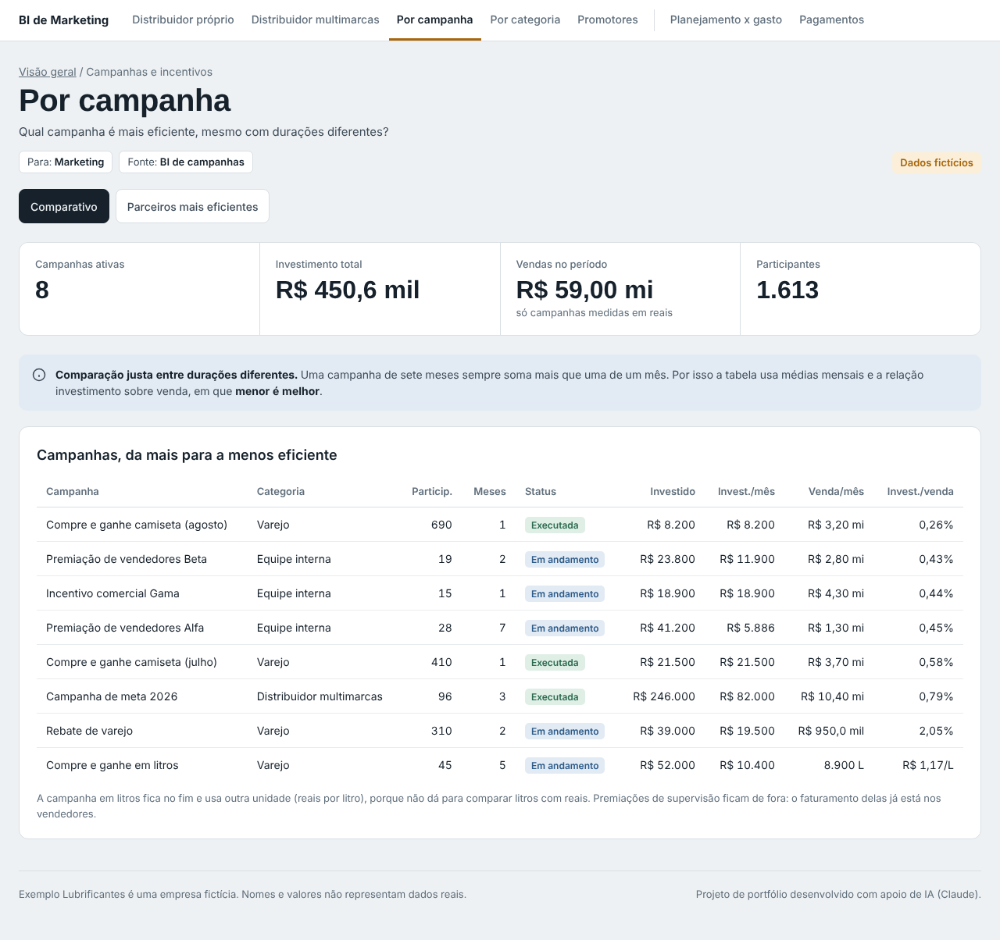
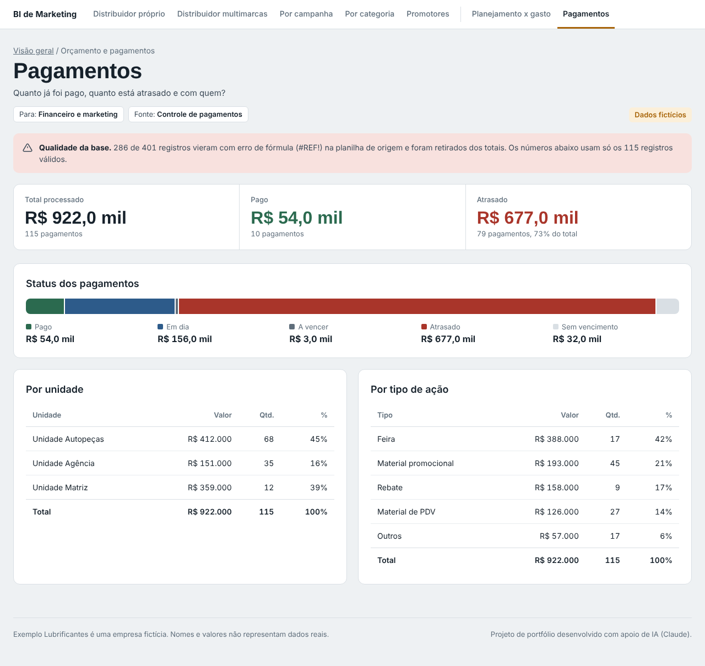

# BI de Marketing B2B

Conjunto de sete painéis que reúne os resultados de marketing de uma indústria de lubrificantes que vende por distribuidores: campanhas de incentivo, orçamento previsto contra gasto, pagamentos e um programa de promotores de venda.

**[Abrir os painéis online](https://SEU-USUARIO.github.io/bi-marketing/)**



> **Sobre os dados:** projeto de portfólio baseado em um trabalho real. Para preservar a empresa, todos os nomes, valores e parceiros foram substituídos por dados fictícios. A estrutura, as regras de negócio e as decisões de análise são as do projeto original.

---

## O problema

A equipe de marketing acompanhava os resultados em quatro fontes separadas: o BI de campanhas, a planilha de orçamento, o controle de pagamentos e o relatório do programa de promotores. Cada uma tinha um período de referência diferente, e cada área da empresa precisava de respostas diferentes. Responder "a campanha funcionou?" ou "quanto do orçamento já foi gasto?" exigia abrir vários arquivos e cruzar números na mão.

## Arquitetura dos painéis

Em vez de um único painel com tudo, organizei o projeto em painéis separados. **Cada painel responde a uma pergunta de negócio, para um público específico.** Isso evita telas sobrecarregadas e deixa claro para cada área onde está a informação de que ela precisa.



A navegação tem três níveis:

1. **Visão geral:** ponto de partida, com os números do ano e uma lista de pontos de atenção que leva direto ao painel certo.
2. **Painéis:** separados em dois grupos, conforme o tipo de decisão que apoiam (comercial ou financeira).
3. **Detalhamentos:** dentro de alguns painéis, para ir do resumo ao nível de equipe, vendedor ou campanha.

| Painel | Pergunta que responde | Para quem |
|---|---|---|
| Distribuidor próprio | A premiação das equipes de venda do grupo está trazendo resultado? | Comercial e gestão das distribuidoras |
| Distribuidor multimarcas | A campanha de meta fez os distribuidores externos venderem mais que o normal? | Comercial e trade marketing |
| Por campanha | Qual campanha é mais eficiente, mesmo com durações diferentes? | Marketing |
| Por categoria | Onde o investimento rende mais: equipe interna, multimarcas ou varejo? | Diretoria e marketing |
| Promotores | Quanto as abordagens dos promotores geraram em vendas? | Trade marketing |
| Planejamento x gasto | Quanto do orçamento anual já foi executado, linha por linha? | Marketing e controladoria |
| Pagamentos | Quanto já foi pago, quanto está atrasado e com quem? | Financeiro e marketing |

Cada painel mostra no topo o seu público e a sua fonte de dados, para que ninguém compare números de bases e períodos diferentes sem perceber.

## O que eu fiz

Usei IA como ferramenta de desenvolvimento (detalhes na próxima seção), mas o entendimento do negócio, a organização dos painéis, a validação dos dados e as decisões de análise foram meus.

**Desenhei a arquitetura.** Defini quais perguntas cada área precisava responder, separei os painéis por público e tipo de decisão e criei os níveis de detalhamento.

**Levantei e cruzei as fontes.** Identifiquei de onde vinha cada número e qual o período de referência de cada base, e deixei isso visível em cada painel.

**Tratei problemas de qualidade dos dados.** A planilha de pagamentos tinha a maior parte dos registros com erro de fórmula (`#REF!`). Retirei esses registros dos totais e deixei um aviso na tela informando quantos foram excluídos.

**Corrigi uma leitura errada do orçamento.** A planilha trazia um campo chamado "verba" com um valor muito alto, que na verdade era a previsão de vendas usada como base de cálculo. O orçamento real é a soma das linhas de campanha.

**Evitei contagem dupla.** As vendas dos supervisores já estavam incluídas nas vendas dos vendedores. Mantive o investimento em supervisão separado, fora da soma.

**Comparei campanhas de forma justa.** Campanhas de um mês e de sete meses não podem ser comparadas pelo total. Usei médias mensais e a relação investimento sobre venda. A campanha medida em litros fica separada, porque não dá para comparar litros com reais.

**Medi a campanha contra o histórico de cada distribuidor.** Comparei cada distribuidor com o próprio baseline, o que revelou que a maioria vendeu abaixo do normal durante a campanha, algo que o total escondia.

**Identifiquei outliers.** No programa de promotores, dois contatos respondiam por quase todo o valor. O painel os exclui por padrão e tem uma opção para incluí-los.

## Como usei IA

Desenvolvi os painéis com o apoio do **Claude**, assistente de IA da Anthropic. A divisão de trabalho foi esta:

- **Minha parte:** entender o negócio, reunir e conhecer as bases, definir as perguntas, os públicos e a organização dos painéis, escolher os indicadores, validar se os números batiam com as fontes, identificar os problemas de dados e decidir como tratá-los, revisar o resultado até ficar correto.
- **Parte da IA:** gerar e ajustar o código HTML, CSS e JavaScript a partir das minhas instruções, sugerir formas de visualização e acelerar a construção do layout.

Vejo a IA como uma ferramenta de produtividade, como uma biblioteca de gráficos ou o próprio Excel. O valor do projeto está nas decisões de análise e de organização acima, que exigiram conhecer o negócio e questionar os dados.

## Decisões técnicas

- **Uma base de dados, sete painéis.** Todos os painéis leem o mesmo arquivo `dados.js`. Os dados de cada equipe vêm da campanha correspondente, então um número nunca aparece com valores diferentes em dois painéis.
- **Nada é digitado duas vezes.** Totais, percentuais e médias são calculados em `comum.js` a partir das linhas da base.
- **Estrutura compartilhada.** Barra de navegação, cabeçalho, avisos e indicadores são componentes do `comum.js`, e o visual fica todo em `estilo.css`. Para criar um painel novo, basta uma página com a lógica específica dele.
- **Links diretos para cada detalhamento**, como `paineis/distribuidor-proprio.html#alfa`, para compartilhar exatamente a tela certa.
- HTML, CSS e JavaScript puro, sem frameworks, responsivo e com modo escuro automático. Hospedagem gratuita no GitHub Pages.

## Estrutura

```
bi-marketing/
├── index.html                  # visão geral e mapa dos painéis
├── paineis/
│   ├── distribuidor-proprio.html
│   ├── multimarcas.html
│   ├── campanhas.html
│   ├── categorias.html
│   ├── promotor.html
│   ├── planejamento.html
│   └── pagamentos.html
├── assets/
│   ├── dados.js                # base fictícia única
│   ├── comum.js                # cálculos e estrutura compartilhada
│   └── estilo.css              # visual de todos os painéis
├── prints/                     # capturas usadas neste README
└── README.md
```

## Algumas telas

| Distribuidor multimarcas | Por categoria |
|---|---|
|  |  |
| **Por campanha** | **Pagamentos** |
|  |  |

## Como rodar

Não precisa instalar nada: baixe o repositório e abra o `index.html` no navegador.

Para publicar no GitHub Pages, vá em **Settings > Pages** no repositório, escolha a branch `main` e a pasta `/ (root)`, e salve. Em alguns minutos o site fica disponível em `https://SEU-USUARIO.github.io/NOME-DO-REPOSITORIO/`.

## Autor

**Gustavo Garré**, CRM e Dados
[LinkedIn](https://www.linkedin.com/in/SEU-PERFIL)
